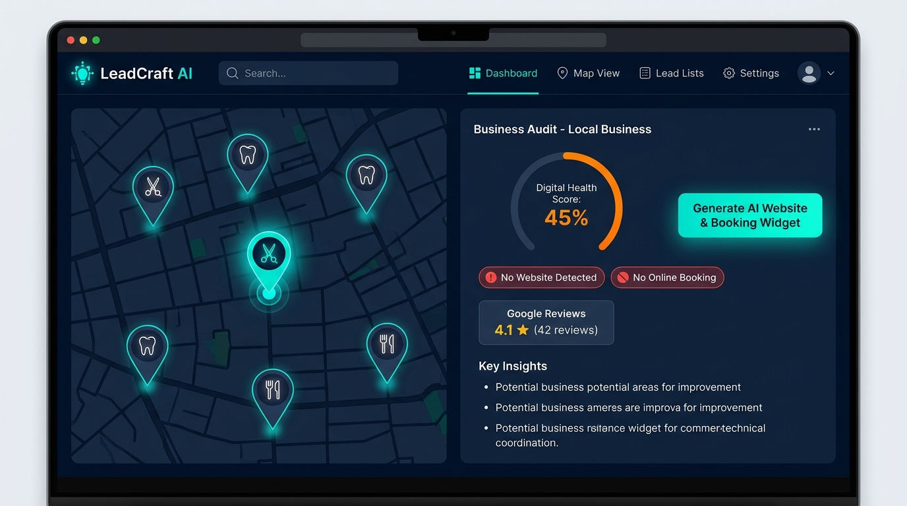

# LeadCraft AI 🗺️🤖💼
> **Plataforma Inteligente de Prospección Geográfica, Auditoría Digital y Generación Asistida de Soluciones Web para Pequeños Negocios Locales**  
> *Proyecto Intermodular — 2º DAM (Curso 2026/2027)*  
> **Alumno:** Kevin Muñoz Córcoles ([Kaik180](https://github.com/Kaik180))

---

## 📌 1. Visión General del Proyecto

**LeadCraft AI** es una solución B2B SaaS de software multiplataforma (escritorio y web) diseñada para impulsar la digitalización del comercio local de proximidad:
1. **Exploración y Prospección en Google Maps:** Permite buscar y seleccionar pequeños negocios locales (barberías, clínicas, talleres, restaurantes) por barrio o sector.
2. **Motor de Auditoría Digital Express:** Escanea en segundos si el negocio carece de página web, certificado HTTPS, sistema de reservas online o perfiles en redes sociales.
3. **Generación Asistida por IA:** A partir de los datos públicos de Maps (fotos, horarios, reseñas), una API de IA (Gemini / OpenAI) redacta los textos y monta una landing page moderna con un widget interactivo de citas online y contacto directo por WhatsApp.
4. **Dossier Comercial:** Genera un informe de auditoría en PDF listo para que el comercial o freelancer presente la propuesta en persona o por mensaje.

*Figura 1: Pantalla principal de búsqueda sobre Google Maps y panel lateral de auditoría digital de un negocio local.*

---

## ⚡ 2. Funcionalidades Principales

| Funcionalidad | Descripción |
| :--- | :--- |
| **Búsqueda Geográfica en Maps** | Explorador sobre Google Maps para localizar comercios clasificados por categoría y zona geográfica. |
| **Auditoría Digital Express** | Detección automática en 3 segundos de carencias críticas: ausencia de web, falta de reservas y reputación. |
| **Generador de Landing Pages con IA** | Generación de webs responsivas adaptadas al sector mediante plantillas inteligentes y redacción con LLM. |
| **Widget de Citas y Reservas** | Sistema incrustado de calendario de reservas con franjas horarias y confirmación. |
| **Previsualizador en Vivo** | Vista previa interactiva con opción de editar textos, precios y colores antes de exportar. |
| **Dossier en PDF y Enlace WhatsApp** | Generación automática de informe comercial en PDF y mensaje personalizado para contactar al dueño. |

---

## 🌍 3. Impacto y Objetivos de Desarrollo Sostenible (ODS)

- **ODS 8: Trabajo Decente y Crecimiento Económico:** Fomenta la competitividad y digitalización de microempresas y pymes locales frente a las grandes cadenas.
- **ODS 9: Industria, Innovación e Infraestructura:** Democratiza el acceso a herramientas de inteligencia artificial y presencia web para el comercio de barrio.

---

## 📂 4. Entregables del Repositorio

- 📄 [`Tarea0_LeadCraft_Kevin.docx`](./Tarea0_LeadCraft_Kevin.docx): Documento oficial en Word formateado según la rúbrica (portada + 2 páginas de contenido, Calibri 14pt títulos, Calibri 12pt texto, interlineado 1.5, cabecera, pie con número, índice enlazable, tabla y fuentes).
- 📄 [`Tarea0_LeadCraft_Kevin.pdf`](./Tarea0_LeadCraft_Kevin.pdf): Versión PDF oficial del documento en 3 páginas exactas.
- 📊 [`Tarea0_LeadCraft_Presentacion.pptx`](./Tarea0_LeadCraft_Presentacion.pptx): Presentación en PowerPoint de exactamente 3 diapositivas visuales (Problema, Solución y Valor Añadido).
- 📊 [`Tarea0_LeadCraft_Presentacion.pdf`](./Tarea0_LeadCraft_Presentacion.pdf): Versión PDF de la presentación en 3 diapositivas 16:9.
- 🖼️ [`mockup_leadcraft.jpg`](./mockup_leadcraft.jpg): Prototipo de interfaz de LeadCraft AI.

---

## 📚 5. Fuentes Consultadas

- [Instituto Nacional de Estadística (INE) — Encuesta de TIC en empresas](https://www.ine.es)
- [Google Cloud — Google Places API Documentation](https://developers.google.com/maps)
- [Naciones Unidas — ODS 8: Trabajo Decente y Crecimiento Económico](https://www.un.org/sustainabledevelopment/es/economic-growth/)
