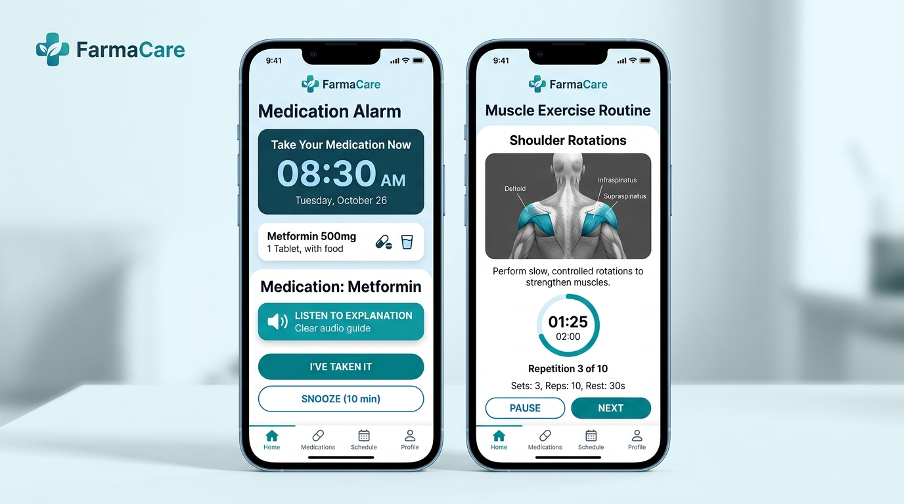

# FarmaCare & Physio 💊🏃
> **Asistente Móvil Inteligente para la Gestión de Tratamientos Farmacológicos y Rehabilitación Muscular Asistida**  
> *Proyecto Intermodular — 2º DAM (Curso 2026/2027)*  
> **Alumno:** Kevin ([Kaik180](https://github.com/Kaik180))

---

## 📌 1. Visión General del Proyecto

**FarmaCare & Physio** es una propuesta de solución digital multiplataforma (Android / iOS) orientada a resolver dos problemas interconectados en el ámbito sociosanitario cotidiano:
1. **La falta de adherencia farmacológica**, los olvidos y la confusión en la posología diaria en pacientes polimedicados, personas de edad avanzada o con deterioro cognitivo leve / Alzheimer temprano.
2. **El abandono y la mala ejecución de la rehabilitación física domiciliaria**, proporcionando rutinas guiadas y accesibles para fortalecer grupos musculares ante traumatismos, contracturas o dolores posturales crónicos.

---

## 🚨 2. Problema o Necesidad Detectada

- **¿Qué ocurre?** Según la Organización Mundial de la Salud (OMS), hasta el 50% de los pacientes con enfermedades crónicas no cumplen adecuadamente su tratamiento médico. Además, los prospectos son difíciles de leer y comprender. En el área física, las recomendaciones de rehabilitación en hojas de papel se extravían con facilidad y no garantizan una ejecución técnica correcta.
- **¿A quién afecta?** 
  - Personas mayores y enfermos en fases iniciales de demencia/Alzheimer.
  - Cuidadores y familiares que sufren estrés y sobrecarga mental supervisando las tomas diarias.
  - Pacientes con lesiones traumatológicas o dolores musculoesqueléticos que requieren ejercicios de fortalecimiento.
- **¿Por qué puede mejorarse?** Los smartphones permiten avisos sonoros con locución hablada, interfaces de alto contraste y videoguías paso a paso, convirtiendo una pauta médica pasiva en un acompañamiento activo y seguro.

---

## 📱 3. Solución Digital

Una aplicación móvil con interfaz universal adaptada (**"Modo Senior"** con botones y textos grandes) que ofrece:
- **Botiquín Digital Inteligente:** Alarmas audibles y habladas que indican el nombre del medicamento, la dosis, para qué sirve y cómo tomarlo.
- **Confirmación con Aviso a Cuidadores:** Botón de un solo toque para registrar la toma. Si tras 20 minutos no se confirma, se notifica automáticamente al cuidador.
- **Fisioterapia y Fortalecimiento Muscular:** Rutinas visuales organizadas por zona corporal (cuello, espalda, hombro, rodilla) con temporizadores y consejos posturales.

---

## 🖼️ 4. Prototipo Visual de Interfaz (Mockup)

*Figura 1: Pantalla izquierda (Alarma de medicación y locución explicativa) | Pantalla derecha (Rutina guiada de fortalecimiento muscular).*

---

## ⚡ 5. Tabla de Funcionalidades Principales

| Funcionalidad | Descripción |
| :--- | :--- |
| **Registro y Perfil Dual** | Configuración de perfiles adaptados: modo autónomo, modo asistido (tercera edad) y modo cuidador supervisor. |
| **Alarmas con Locución por Voz** | Avisos acústicos y síntesis de voz que explican el fármaco, la posología y si requiere ingerirse con alimentos. |
| **Confirmación de Toma y Antiolvido** | Botón táctil de gran visibilidad para confirmar la ingesta; previene tomas dobles accidentales. |
| **Alertas de Seguridad a Cuidadores** | Envío de notificación push/SMS al contacto designado si una toma no ha sido confirmada a tiempo. |
| **Módulo de Fisioterapia y Ejercicios** | Catálogo interactivo de ejercicios con temporizador, series y enfoque anatómico por dolor o traumatismo. |
| **Prospecto Claro y Accesible** | Ficha simplificada en lenguaje no técnico con indicaciones, advertencias y contraindicaciones clave. |
| **Historial Clínico en PDF** | Reporte mensual de cumplimiento farmacológico y actividad física para presentar al médico o fisioterapeuta. |

---

## 🚀 6. Mejoras Futuras y Escalabilidad

1. **Visión por Computador (Computer Vision):** Evaluación postural en tiempo real a través de la cámara frontal durante los ejercicios de rehabilitación para corregir errores.
2. **Integración con Wearables e IoT:** Vibración háptica de recordatorio en pulseras/relojes inteligentes, detección de caídas y vinculación con pastilleros inteligentes conectados.
3. **Escaneo OCR de Cajas de Medicamentos:** Carga rápida de tratamientos fotografiando la caja del medicamento o escaneando el código Datamatrix/código de barras.
4. **Interoperabilidad con Receta Electrónica:** Sincronización oficial con los sistemas autonómicos de salud pública.

---

## 🌍 7. Impacto y Objetivos de Desarrollo Sostenible (ODS)

- **ODS 3: Salud y Bienestar:** Fomenta la adherencia farmacológica, disminuye ingresos hospitalarios por errores de dosificación y acelera la recuperación física motora.
- **ODS 10: Reducción de las Desigualdades:** Rompe la brecha digital en personas mayores y con diversidad funcional mediante diseño accesible universal.

---

## 📂 8. Estructura y Entregables del Repositorio

- 📄 [`Tarea0_FarmaCare_Kevin.docx`](./Tarea0_FarmaCare_Kevin.docx): Documento oficial en Word formateado según los requisitos de la tarea (portada + 2 páginas de contenido, Calibri 14pt títulos, Calibri 12pt texto, interlineado 1.5, cabecera, pie de página, índice enlazable, tabla, enlaces y bibliografía).
- 📊 [`Tarea0_FarmaCare_Presentacion.pptx`](./Tarea0_FarmaCare_Presentacion.pptx): Presentación en PowerPoint de 3 diapositivas visuales (Problema, Solución y Valor Añadido).
- 🖼️ [`mockup_farmacare.jpg`](./mockup_farmacare.jpg): Diseño conceptual de las pantallas principales de la aplicación.
- ⚙️ [`generate_word.py`](./generate_word.py): Script en Python para la generación automatizada del documento Word cumpliendo todas las directrices.
- ⚙️ [`generate_slides.py`](./generate_slides.py): Script en Python para la creación de la presentación en diapositivas 16:9.

---

## 📚 9. Fuentes Consultadas

- [Organización Mundial de la Salud (OMS) — Adherencia terapéutica](https://www.who.int/es/publications/i/item/9241545992)
- [Sociedad Española de Geriatría y Gerontología (SEGG) — Polimedicación en el anciano](https://www.segg.es)
- [Naciones Unidas — ODS 3: Salud y Bienestar](https://www.un.org/sustainabledevelopment/es/health/)
