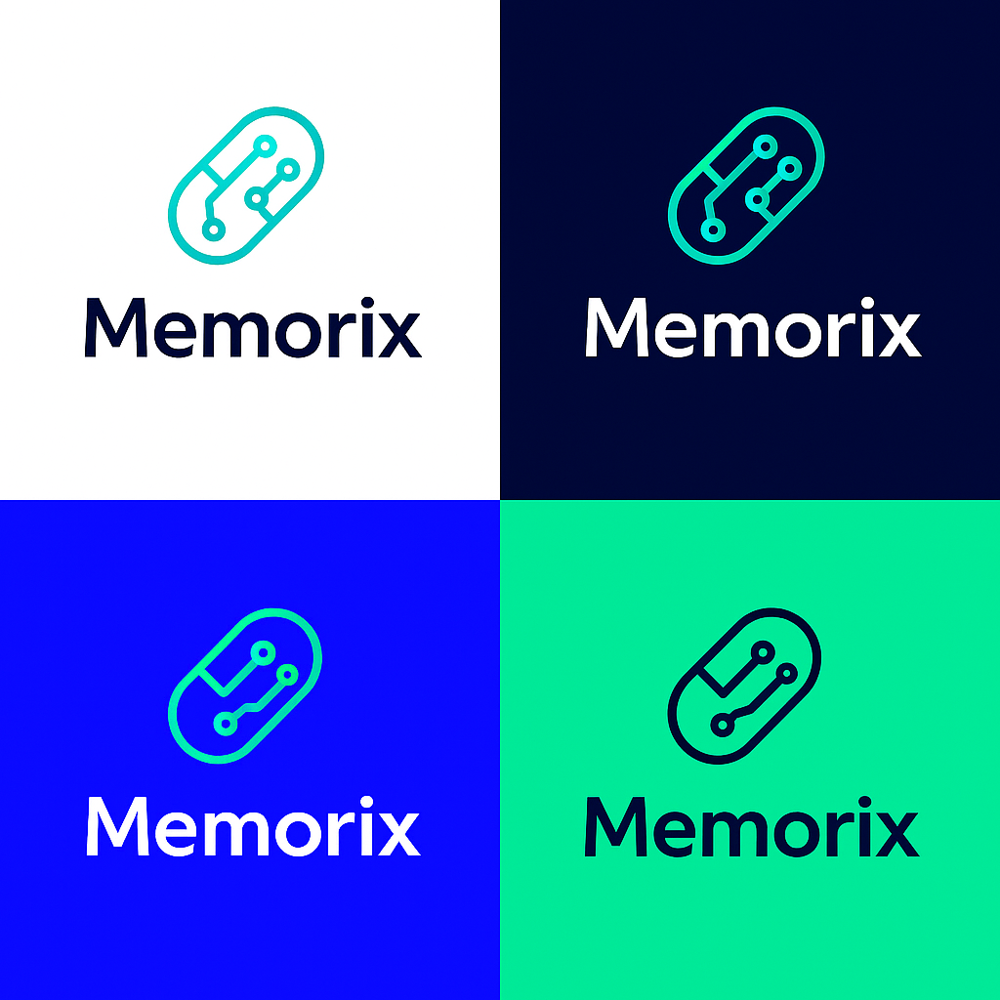
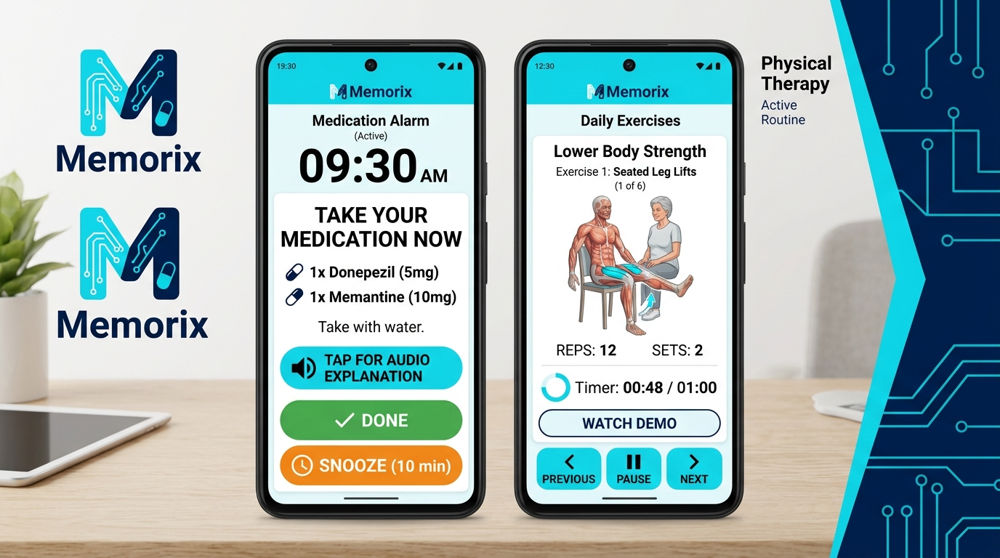

# Memorix 💊⚡🏃
> **Asistente Móvil Inteligente para la Gestión de Tratamientos Farmacológicos y Rehabilitación Muscular Asistida**  
> *Proyecto Intermodular — 2º DAM (Curso 2026/2027)*  
> **Alumno:** Kevin ([Kaik180](https://github.com/Kaik180))

---

## 🎨 1. Identidad de Marca y Accesibilidad Cromática

**Memorix** nace con una identidad visual fuertemente vinculada a su propósito:
- **Isotipo:** Una cápsula/pastilla fusionada con pistas de circuito impreso, simbolizando la unión entre la medicina/farmacología y la tecnología inteligente al servicio de la memoria humana.
- **Paleta de Contrastes Accesibles:** El diseño gráfico contempla cuatro variantes de alto contraste cromático basadas en las directrices de accesibilidad universal **WCAG AAA**. Esta distinción cromática es vital para evitar barreras visuales y cognitivas en personas de la tercera edad o pacientes con fases tempranas de Alzheimer.

*Figura 1: Sistema de contrastes e identidad visual oficial de Memorix.*

---

## 📌 2. Visión General del Proyecto

**Memorix** es una propuesta de solución digital multiplataforma (Android / iOS) orientada a dar respuesta coordinada a dos grandes necesidades sociosanitarias:
1. **La falta de adherencia farmacológica**, los olvidos habituales y la confusión en la posología en pacientes polimedicados, personas de edad avanzada o con deterioro cognitivo leve / Alzheimer temprano.
2. **El abandono y la ejecución incorrecta de la rehabilitación física domiciliaria**, ofreciendo rutinas activas y guiadas para fortalecer grupos musculares dañados por dolores posturales crónicos o traumatismos físicos.

---

## 🚨 3. Problema o Necesidad Detectada

- **¿Qué ocurre?** Según la Organización Mundial de la Salud (OMS), hasta un 50% de los pacientes con patologías crónicas no cumplen adecuadamente su pauta médica. Los prospectos tienen letra ilegible y lenguaje incomprensible. Al mismo tiempo, las recomendaciones de ejercicios físicos en hojas de papel se pierden o se ejecutan con mala postura, empeorando las lesiones.
- **¿A quién afecta?** 
  - Personas mayores y enfermos en fases iniciales de demencia/Alzheimer.
  - Cuidadores y familiares sometidos a estrés continuo y sobrecarga mental.
  - Personas con dolores musculares o traumatismos que requieren fortalecimiento físico asistido.
- **¿Por qué puede mejorarse?** Los smartphones permiten sustituir el papel por avisos sonoros con locución hablada, interfaces de alto contraste y guías de ejercicios con temporizador visual, creando un acompañamiento activo, cercano y seguro.

---

## 📱 4. Solución Digital: Memorix

Una aplicación móvil con interfaz simplificada (**"Modo Senior de Alto Contraste"**) que ofrece:
- **Botiquín Digital Inteligente:** Alarmas sonoras que leen por voz el nombre del fármaco, la dosis, para qué sirve y cómo debe tomarse (ej. con comida o abundante agua).
- **Confirmación Antiolvido y Alerta SOS a Cuidadores:** Botón gigante de confirmación de un solo toque. Si pasan 20 minutos sin confirmarse una toma crítica, se alerta automáticamente al familiar supervisor.
- **Fisioterapia y Fortalecimiento Muscular Guiado:** Módulo interactivo con rutinas visuales por grupo muscular (hombros, cuello, espalda, rodillas) con conteo de series y tiempos de descanso.

*Figura 2: Pantalla de Alarma Farmacológica con Locución por Voz (izquierda) y Módulo de Ejercicios Guiados con Temporizador (derecha).*

---

## ⚡ 5. Tabla de Funcionalidades Principales

| Funcionalidad | Descripción |
| :--- | :--- |
| **Registro y Perfil Dual** | Perfiles adaptados: modo autónomo, modo asistido (para mayores) y perfil de cuidador supervisor. |
| **Alarmas con Locución por Voz** | Avisos sonoros que reproducen por síntesis de voz el nombre del medicamento, dosis e instrucciones comprensibles. |
| **Confirmación de Toma de Un Toque** | Botón táctil de gran formato para confirmar la ingesta; previene tomas duplicadas por despistes. |
| **Alerta SOS a Cuidadores** | Notificación push/SMS automática al contacto designado si una toma prioritaria no es confirmada a tiempo. |
| **Módulo de Fisioterapia Activa** | Catálogo interactivo de ejercicios con series, repeticiones y temporizador para dolores o traumatismos. |
| **Prospecto Claro y Accesible** | Ficha simplificada sin tecnicismos que resume la utilidad de la pastilla, advertencias e incompatibilidades. |
| **Modo Contraste Memorix** | Temas visuales optimizados (azul oscuro, cian, menta y blanco) diseñados para máxima legibilidad visual (WCAG). |

---

## 🚀 6. Mejoras Futuras y Escalabilidad

1. **Visión por Computador (Computer Vision):** Evaluación postural en tiempo real a través de la cámara frontal durante los ejercicios de rehabilitación para corregir errores.
2. **Integración con Wearables e IoT:** Vibración háptica de recordatorio en pulseras/relojes inteligentes, detección de caídas y vinculación con pastilleros inteligentes conectados.
3. **Escaneo OCR de Cajas de Medicamentos:** Carga rápida de tratamientos fotografiando la caja del medicamento o escaneando el código Datamatrix/código de barras.
4. **Interoperabilidad con Receta Electrónica:** Sincronización oficial con los sistemas autonómicos de salud pública.

---

## 🌍 7. Impacto y Objetivos de Desarrollo Sostenible (ODS)

- **ODS 3: Salud y Bienestar:** Fomenta la adherencia farmacológica, reduce visitas innecesarias a urgencias y estimula la recuperación física motora.
- **ODS 10: Reducción de las Desigualdades:** Rompe la brecha digital en personas mayores y con diversidad funcional mediante diseño accesible universal.

---

## 📂 8. Estructura y Entregables del Repositorio

- 📄 [`Tarea0_Memorix_Kevin.docx`](./Tarea0_Memorix_Kevin.docx): Documento oficial en Word formateado según los requisitos de la tarea (portada con logo + 2 páginas de contenido, Calibri 14pt títulos, Calibri 12pt texto, interlineado 1.5, cabecera, pie de página con número dinámico, índice enlazable, tabla de funcionalidades, enlaces y fuentes).
- 📊 [`Tarea0_Memorix_Presentacion.pptx`](./Tarea0_Memorix_Presentacion.pptx): Presentación en PowerPoint de exactamente 3 diapositivas visuales (Problema, Solución Memorix y Valor Añadido).
- 🎨 [`contrastes.png`](./contrastes.png): Identidad de marca y cuadrante de contrastes cromáticos de Memorix.
- 📱 [`mockup_memorix.jpg`](./mockup_memorix.jpg): Prototipo de interfaz móvil con el branding oficial de Memorix.
- ⚙️ [`generate_word.py`](./generate_word.py): Script en Python para generar el documento Word.
- ⚙️ [`generate_slides.py`](./generate_slides.py): Script en Python para generar la presentación PowerPoint.

---

## 📚 9. Fuentes Consultadas

- [Organización Mundial de la Salud (OMS) — Adherencia terapéutica](https://www.who.int/es/publications/i/item/9241545992)
- [Sociedad Española de Geriatría y Gerontología (SEGG) — Polimedicación en el anciano](https://www.segg.es)
- [Naciones Unidas — ODS 3: Salud y Bienestar](https://www.un.org/sustainabledevelopment/es/health/)
