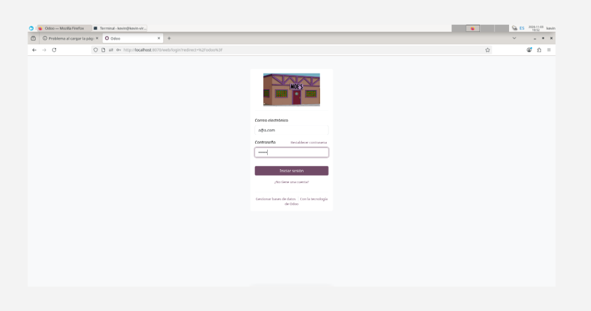
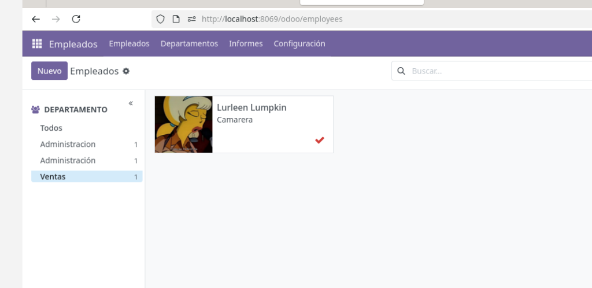
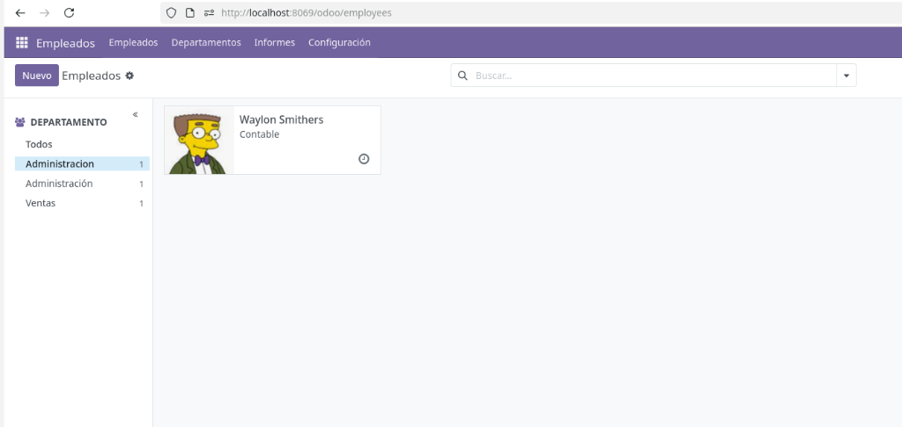
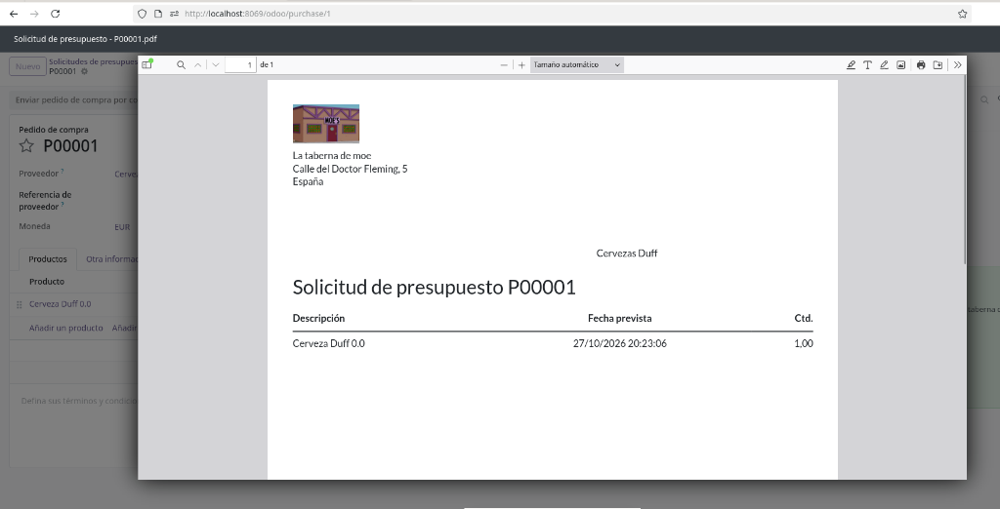
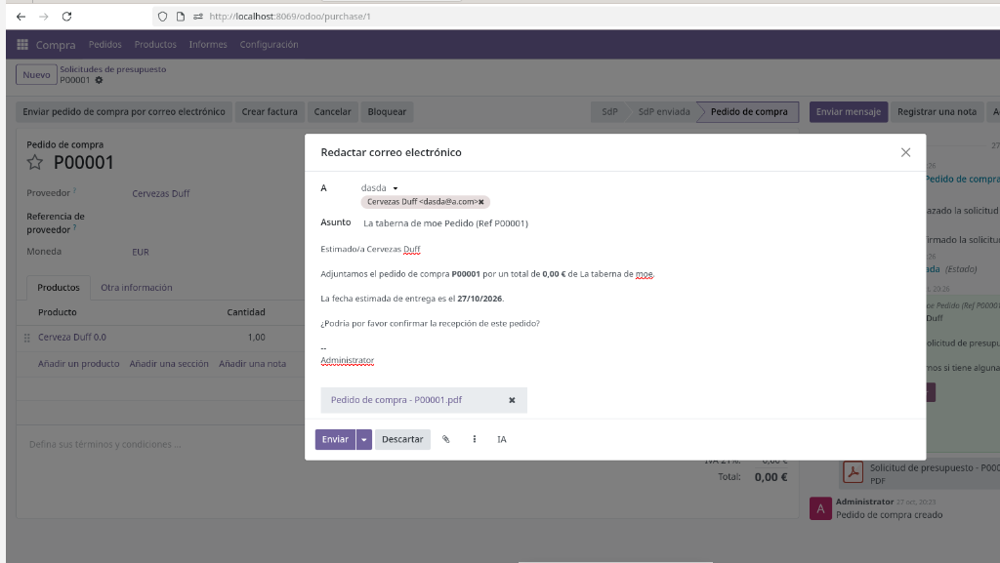
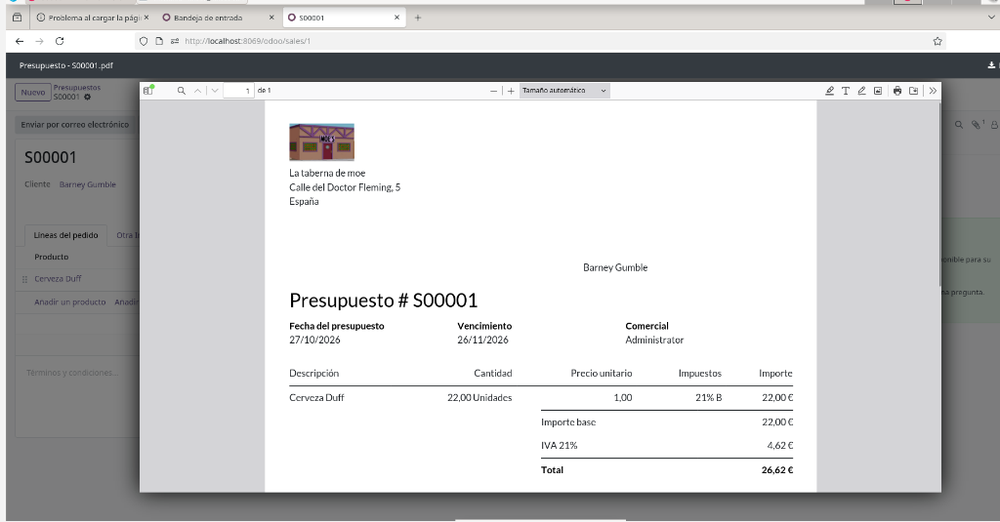
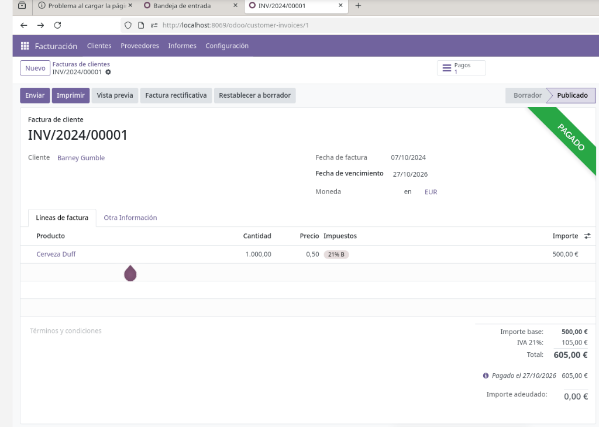
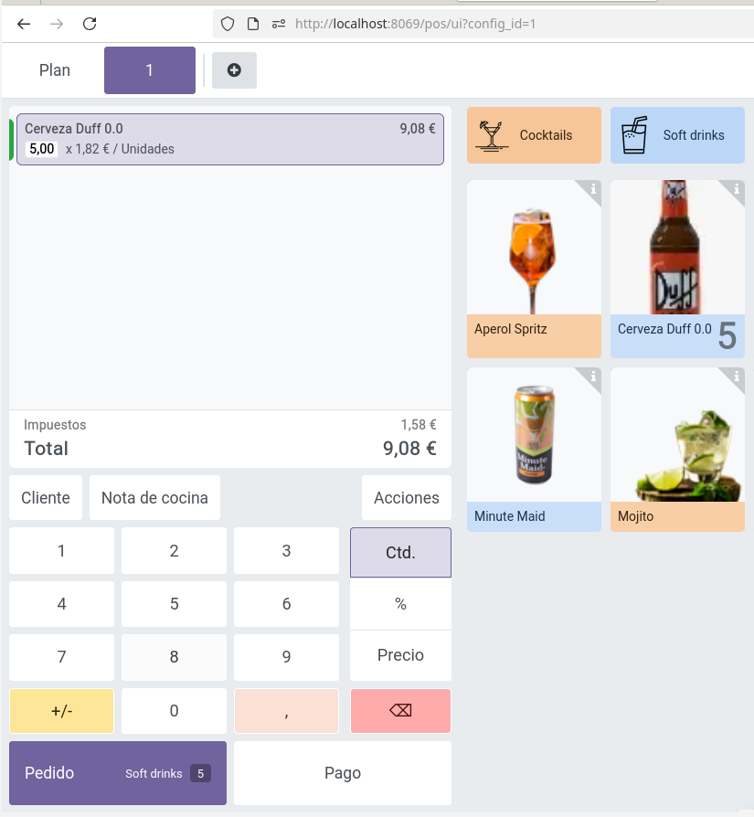
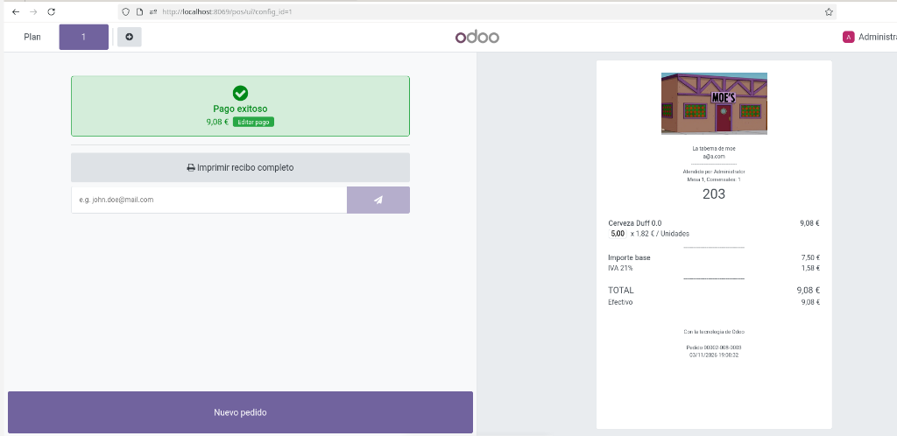
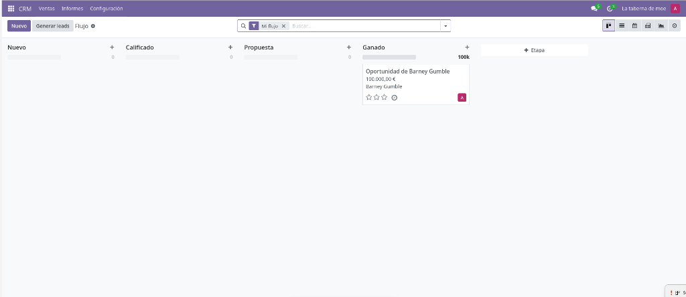

# SGE - Práctica UD04: Implantación de un ERP en la Empresa (Odoo v18)

**Alumno:** Kevin  
**Curso:** 2º Desarrollo de Aplicaciones Multiplataforma (DAM)  
**Módulo:** Sistemas de Gestión Empresarial (SGE)  
**Actividad:** Supuesto Práctico "La Taberna de Moe" (UD04) - Configuración Modular, Despliegue con Docker y Migración de Datos  
**Documento Oficial:** [Descargar Memoria Técnica en PDF (11 Páginas)](./Memoria_Practica_UD04_Kevin_Odoo.pdf)  

---

## 📌 Resumen del Proyecto

Este proyecto recoge la implantación integral, parametrización y posterior migración del sistema ERP **Odoo v18** sobre contenedores **Docker** y motor de bases de datos relacional **PostgreSQL 15** en un entorno Debian Linux. 

A través del supuesto práctico de **"La Taberna de Moe"**, se han configurado e interconectado los módulos clave de gestión empresarial:
1. **Configuración Corporativa y Localización Fiscal:** Alta de empresa con domicilio en España (Calle del Doctor Fleming, 5), plan contable e IVA general al 21%, asociando la imagen corporativa oficial.
2. **Facturación, Clientes y Proveedores:** Gestión de compras y ventas iniciales. Conciliación y liquidación de factura formal a nombre de *Barney Gumble* (`INV/2024/00001`) en estado pagado por 605,00 €.
3. **Módulo de Empleados (RRHH):** Definición de organigrama departamental (*Ventas* y *Administración*) y alta de las fichas de personal con imagen y usuario de Odoo vinculado:
   - **Lurleen Lumpkin** (Camarera - Departamento de Ventas).
   - **Waylon Smithers** (Contable - Departamento de Administración).
4. **Módulo de Compras (Aprovisionamiento):** Alta del proveedor estratégico *Cervezas Duff*, registro del producto *Cerveza Duff 0.0*, emisión de Solicitud de Presupuesto formal en PDF (`P00001`) y confirmación a Pedido de Compra con notificación por email.
5. **Módulo de Ventas:** Elaboración de presupuesto comercial en PDF (`#S00001`) para *Barney Gumble*, confirmación del pedido y generación automática de la factura vinculada.
6. **Punto de Venta (TPV / POS):** Configuración de productos con catálogo fotográfico en barra, atención de comanda de 5 unidades de Cerveza Duff 0.0, cobro en efectivo y emisión del ticket simplificado reglamentario.
7. **Módulo Empresarial Adicional (CRM):** Configuración del pipeline de ventas, gestionando una oportunidad comercial ganada de *Barney Gumble* por importe de 100.000,00 €.
8. **Copia de Seguridad y Migración Geográfica:** Respaldo completo de la base de datos `taverna` (volcado relacional de **26 MB** con `pg_dump`), fichero de configuración `odoo.conf` y empaquetado del `filestore` y sesiones (**6.3 MB**). Reorquestación en nuevo puerto anfitrión (**8070**) y restauración limpia y verificada de todos los datos.

---

## 📂 Estructura de la Carpeta

```text
practica_taberna_moe/
│
├── Memoria_Practica_UD04_Kevin_Odoo.pdf   <-- Memoria completa maquetada (11 páginas)
├── README.md                             <-- Documento resumen y guía rápida
├── generar_memoria.py                    <-- Script generador del PDF con ReportLab
│
└── capturas/                             <-- Evidencias gráficas con pie de imagen
    ├── 01_datos_empresa_login_8070.png
    ├── 02_presupuesto_s00001_barney_pdf.png
    ├── 03_factura_barney_inv202400001_pagada.png
    ├── 04_facturacion_listado_facturas.png
    ├── 05_empleados_lurleen_lumpkin_ventas.png
    ├── 06_empleados_waylon_smithers_administracion.png
    ├── 07_compra_solicitud_presupuesto_p00001_duff_pdf.png
    ├── 08_compra_pedido_compra_p00001_duff_confirmado.png
    ├── 09_ventas_pedido_s00001_factura_generada.png
    ├── 10_tpv_productos_duff_pedido_5cervezas.png
    ├── 11_tpv_ticket_recibo_pago_efectivo.png
    ├── 12_crm_oportunidad_barney_ganada.png
    ├── 13_backup_verificacion_bd_taverna.png
    ├── 14_backup_pg_dump_26mb.png
    ├── 15_backup_archivos_directorio_baks.png
    ├── 16_migracion_compose_puerto_8070.png
    ├── 17_migracion_restauracion_sql_exitosa.png
    └── 18_migracion_verificacion_contenedores_up.png
```

---

## 📸 Evidencias Gráficas Destacadas

### 1. Datos Corporativos y Verificación en Nuevo Puerto (8070)
  
*Figura 1: Pantalla de inicio de sesión con el logotipo corporativo de "La Taberna de Moe" tras la migración al puerto 8070.*

### 2. Recursos Humanos: Fichas de Empleados por Departamento
| Lurleen Lumpkin (Ventas) | Waylon Smithers (Administración) |
| :---: | :---: |
|  |  |
| *Figura 5: Ficha en departamento de Ventas.* | *Figura 6: Ficha en departamento de Administración.* |

### 3. Aprovisionamiento y Compras (Cervezas Duff)
| Solicitud de Presupuesto en PDF | Confirmación y Redacción de Correo |
| :---: | :---: |
|  |  |
| *Figura 7: Solicitud formal P00001 para Cerveza Duff 0.0.* | *Figura 8: Pedido confirmado y envío automático.* |

### 4. Circuito de Ventas y Facturación (Barney Gumble)
| Presupuesto Formal #S00001 | Factura Conciliada Pagada |
| :---: | :---: |
|  |  |
| *Figura 2: Presupuesto emitido a Barney Gumble.* | *Figura 3: Factura INV/2024/00001 pagada (605,00 €).* |

### 5. Terminal Punto de Venta (TPV) y Ticket de Compra
| Comanda de 5 Cervezas Duff 0.0 | Recibo Oficial Emitido |
| :---: | :---: |
|  |  |
| *Figura 10: Productos con imagen y pedido cargado.* | *Figura 11: Ticket final con desglose impositivo de IVA.* |

### 6. Módulo Adicional: CRM y Oportunidades Comerciales
  
*Figura 12: Embudo de ventas del CRM con oportunidad de Barney Gumble ganada (100.000 €).*

---

## 🛠️ Procedimiento de Backup y Migración (Docker / Debian)

### 1. Extracción de la Copia de Seguridad Consistente
```bash
# 1. Comprobar base de datos activa
docker compose exec db psql -U odoo -l

# 2. Volcado relacional con pg_dump (26 MB)
docker compose exec -T db pg_dump -U odoo taverna > ./baks/backup_bd.sql

# 3. Respaldo de odoo.conf
docker cp odood-web-1:/etc/odoo/odoo.conf ./baks/odoo.conf

# 4. Empaquetado comprimido de imágenes y sesiones (6.3 MB)
tar -czvf ./baks/odoo_data_backup.tar.gz -C ./volumesOdoo_NUEVO/odoo filestore sessions
```

### 2. Modificación de `docker-compose.yml` (Nuevo Puerto 8070 y Nuevas Rutas)
```yaml
services:
  web:
    image: odoo:18
    ports:
      - "8070:8069"  # Puerto migrado
    volumes:
      - ./volumesOdoo_Nuevo/addons:/mnt/extra-addons
      - ./volumesOdoo_Nuevo/odoo/filestore:/var/lib/odoo/filestore
      - ./volumesOdoo_Nuevo/odoo/sessions:/var/lib/odoo/sessions
  db:
    image: postgres:15
    volumes:
      - ./volumesOdoo_Nuevo/dataPostgreSQL:/var/lib/postgresql/data
```

### 3. Restauración en el Nuevo Entorno
```bash
# 1. Levantar únicamente el motor PostgreSQL
docker compose up -d db

# 2. Crear la base de datos vacía
docker compose exec -T db psql -U odoo -d postgres -c "CREATE DATABASE taverna OWNER odoo;"

# 3. Restaurar las tablas y datos relacionales
cat ./baks/backup_bd.sql | docker compose exec -T db psql -U odoo -d taverna

# 4. Descomprimir filestore en la nueva ruta
sudo tar -xzvf ./baks/odoo_data_backup.tar.gz -C ./volumesOdoo_Nuevo/odoo/

# 5. Arrancar Odoo y verificar
docker compose up -d
docker compose ps
```

Acceso verificado con éxito en: **`http://localhost:8070`**
