# Mapa Conceptual: Dart vs Java (Unitat 2 - El Llenguatge Dart)

Aquest document dóna resposta a l'**Activitat 2 de la Unitat 2.1**, sintetitzant tots els conceptes clau apresos sobre Dart i establint una comparativa detallada amb Java.

---

## 1. Mapa Conceptual de Dart

```mermaid
graph TD
    A[Llenguatge Dart] --> B[Tipus de Dades & Variables]
    A --> C[Null Safety]
    A --> D[Estructures de Control]
    A --> E[Entrada / Eixida]

    B --> B1[Infèrencia de Tipus: var]
    B --> B2[Immutabilitat: final vs const]
    B --> B3[Tipatge Dinàmic: dynamic]
    B --> B4[Tipus Primitius: int, double, String, bool]
    B --> B5[Col·leccions: List, Set, Map]
    B --> B6[Enumeracions: enum]

    C --> C1["Nullable Type (?)"]
    C --> C2["Null Assertion (!)"]
    C --> C3["Null-Coalescing (??)"]
    C --> C4["Null-Aware Assignment (??=)"]
    C --> C5["Null-Aware Access (?.)"]

    D --> D1["Condicionals (if-else, ternary ?: , switch)"]
    D --> D2["Bucles (for, for..in, forEach, while, do..while)"]

    E --> E1[print i stdout.write]
    E --> E2[stdin.readLineSync]
```



---

## 2. Taula Comparativa: Dart vs Java

| Concepte | Dart | Java |
| :--- | :--- | :--- |
| **Punt d'entrada** | `void main(List<String> args)` o `void main()` lliure (a nivell superior de fitxer). | `public static void main(String[] args)` obligatòriament dins d'una classe. |
| **Sistema de Tipus** | Estàtic amb suport opcional per a dinàmic (`dynamic`). Infecció de tipus potent (`var`). | Estàtic estricte. Des de Java 10 existeix `var` només per a variables locals. |
| **Sound Null Safety** | **Nadiu i obligatori per defecte**. Els tipus no admeten `null` a menys que es declare explícitament amb `?` (ex: `int?`). | **No natiu**. Qualsevol referència pot ser `null` en temps d'execució, causant `NullPointerException`. S'intenta pal·liar amb `Optional<T>`. |
| **Operadors de Null Safety** | `?` (nullable), `!` (assertion), `??` (fallback), `??=` (assignació nul·la), `?.` (accés segur). | Inexistents de forma sintàctica (cal usar `Optional.ofNullable()`, ternaris manuals o llibreries externes com Lombok). |
| **Constants i Immutabilitat** | `const` (temps de compilació, profundament immutable) i `final` (temps d'execució, immutable en referència). | `final` (temps d'execució o compilació per a primitius). Les col·leccions requereixen mètodes com `Collections.unmodifiableList()`. |
| **Col·leccions / Arrays** | No hi ha arrays de baix nivell; s'utilitza directament la classe `List` (`[]`), `Set` i `Map`. | Arrays nadius (`int[]`), més jerarquia de col·leccions (`ArrayList`, `HashSet`, `HashMap`). |
| **Interpolació de Strings** | Nadiu i concís: `"Hola $nom, tens ${edat + 1} anys"`. | Cal utilitzar concatenació (`+`), `String.format()` o des de Java 21+ String Templates. |
| **Funcions de primer ordre** | Funcions a nivell superior, funcions anònimes i fletxa (`=>`) sense necessitat d'estar lligades a una classe. | Totes les funcions són mètodes de classe. S'utilitzen expressions Lambda mitjançant interfícies funcionals (`Function`, `Consumer`, etc.). |
| **Async / Concurrència** | Model basat en un únic fil d'execució amb **Event Loop**, cues *MicroTask*/*Event*, i `Future`/`Stream` amb `async/await`. | Model basat en concurrència real amb fils multithreading (`Thread`, `ExecutorService`, `CompletableFuture`), i recentment Virtual Threads. |

---

## 3. Detall dels Operadors Null-Safe en Dart

1. **Declaració nul·lable (`?`)**:
   ```dart
   String? nom; // Pot contenir un String o null.
   ```
2. **Operador d'asserció no nul·la (`!`)**:
   ```dart
   int longitud = nom!.length; // Assegura al compilador que no és null; llança error si ho és.
   ```
3. **Operador null-coalescing (`??`)**:
   ```dart
   String display = nom ?? "Anònim"; // Si nom és null, utilitza el valor per defecte.
   ```
4. **Assignació null-aware (`??=`)**:
   ```dart
   nom ??= "Valor Inicial"; // Només assigna si actualment és null.
   ```
5. **Accés condicional (`?.`)**:
   ```dart
   int? longitud = nom?.length; // Retorna null si nom és null, sense llançar excepció.
   ```
